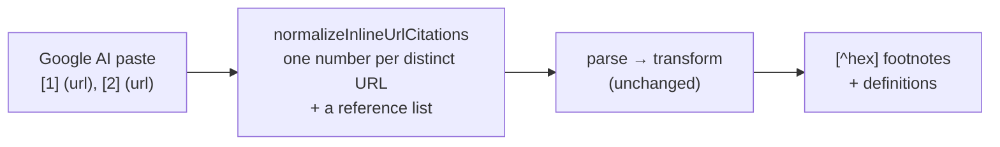

# Google AI pastes convert cleanly again, after Google changed how it cites

## Why Care?

Plenty of research now starts as an AI answer: you ask Google, you get a paragraph with sources, and you want that paragraph in your notes with the sources intact. Cite Wide's **Paste LLM content** command exists for exactly that. Paste the answer, and every numbered citation becomes a stable footnote with its source underneath.

Then Google changed its format, and the paste stopped working. Raw brackets and URLs landed in the note, and every citation was flagged as pointing at nothing. This release teaches Cite Wide the new format.

## What's New?

- **Google AI's new citation style converts to footnotes.** Each `[1] (https://…), [2] (https://…)` group after a sentence becomes `[^a1b2c3] [^d4e5f6]`, with one footnote definition per source.
- **A source cited five times is one footnote.** Google repeats the same link under different numbers. Cite Wide recognizes the URL and gives it one ID everywhere it appears.
- **Google's `•` bullets become real markdown lists**, so they render as a list instead of one run-on paragraph.
- **Works in both commands.** *Paste LLM content* and *Parse LLM citations* (on a note you already pasted into) both handle it.

## What Google changed

The old Google AI format looked like most research tools: numbers inline, a list at the bottom.

```text
Responsible AI is the practice of … social benefit. [1, 2, 3]

[1] [What is Responsible AI? | IBM](https://www.ibm.com/think/topics/responsible-ai)
```

The new one has no list at the bottom. Every sentence carries its own sources, and the numbering starts over at 1 each time:

```text
Responsible AI is the practice of … social benefit. [1] (https://www.ibm.com/…), [2] (https://www.snowflake.com/…)
• Fairness: AI systems must treat people equitably … [1] (https://www.microsoft.com/…), [2] (https://www.youtube.com/…)
```

So `[1]` means a different source in every sentence, and Cite Wide's parser, which expected one shared numbering and a list to look things up in, found nothing to match.

## How it works

Rather than teach every part of the pipeline a second format, a small pre-pass translates the new format into the old one, and the existing, well-tested conversion takes over:



- Numbers are assigned per **URL**, not per position, which is what collapses repeats into one footnote.
- New numbers start above any `[N]` already in the text, so a paste that mixes the old and new formats can't collide.
- Text without these groups passes through untouched, so running the pre-pass on everything is safe.

Google's new format doesn't include page titles, so each new footnote reads `[url](url)` at first. Run **Enrich citations** afterward to fill in titles, authors, and publishers.

## Files Touched

- `src/services/llmCitationParserService.ts`: `normalizeInlineUrlCitations`
- `src/modals/PasteLlmContentModal.ts`, `src/modals/LlmCitationsModal.ts`: run the pre-pass before parsing
- `tests/google-inline-url-citations.test.ts`: four tests from a real paste (dedupe, end-to-end conversion, mixed formats, untouched input)
